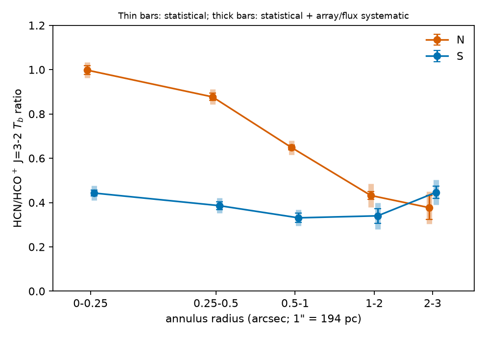
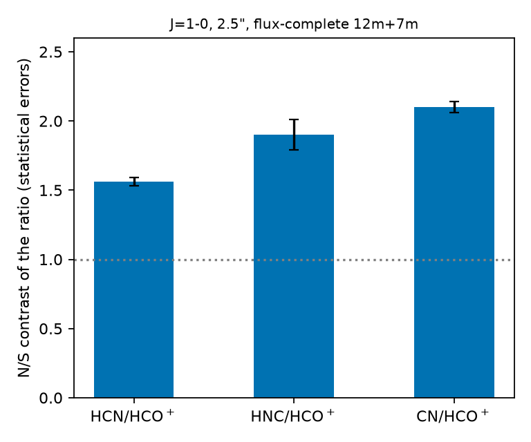

# The HCN/HCO$^+$ J=3–2 ratio rises inward at the starburst nucleus of NGC 3256 but stays low at its low-luminosity AGN

**NGC 3256 paper team**

## Abstract

An elevated HCN/HCO$^+$ ratio in the submillimetre lines is used to flag accreting black holes in dusty nuclei, but the claim is contested. We ask whether it flags the AGN in NGC 3256, whose northern nucleus (N) is a starburst and whose southern nucleus (S) hosts an obscured, low-luminosity AGN, using archival ALMA Band 6 data at 50–250 pc. The HCN/HCO$^+$ J=3–2 brightness-temperature ratio at N rises inward from 0.38 at 2–3$''$ to 1.00 inside 0.25$''$ (49 pc), whereas at S it stays at 0.33–0.44 (0.45 at 2–3$''$). The N/S contrast is about 2 at 50–120 pc in 12-m data (2.1 ± 0.1). This is an upper estimate: missing short spacings cannot be tested below 1$''$, and adding them lowers the contrast by 0.1–0.3 at 1.5–2.2$''$. Flux-complete, the contrast is 1.44 at 430 pc, close to the value already published for a 1.7$''$ beam. HCN, HNC and CN are all weak relative to HCO$^+$ at S. No vibrationally excited HCN is seen at either nucleus (beam-filling surface density below 0.02 $L_\odot$ pc$^{-2}$); this excludes CON-level pumping at N only marginally and not at S. The cause of the contrast (abundance, opacity, $^{12}$C/$^{13}$C or excitation) is not separated. In this one galaxy, whose AGN is energetically minor, the ratio does not flag the AGN.

## 1 Introduction

The HCN/HCO$^+$ ratio of rotational transitions is a long-used diagnostic of the state of dense gas in galaxies. Observations of J=3–2 and 4–3 led several groups to report a "submillimetre HCN enhancement": higher HCN/HCO$^+$ in nuclei hosting active galactic nuclei (AGN) than in starbursts, interpreted as the signature of X-ray or mechanical heating, or of AGN-driven chemistry (Izumi et al. 2016; Imanishi et al. 2016). The claim is contested. Resolved ALMA observations of luminous and ultraluminous infrared galaxies find a wide spread of ratios with no trend with AGN luminosity, and associate the highest ratios with shock-heated outflows (Nishimura et al. 2024). High ratios can also arise from abundance differences (Butterworth et al. 2022) or from infrared pumping of HCN through its bending mode in compact obscured nuclei (CONs; Aalto et al. 2015), in which case vibrationally excited HCN lines should be visible.

NGC 3256 ($D\approx40$ Mpc, $1''\approx194$ pc) has two nuclei separated by about 5$''$ (1 kpc): a starburst-dominated northern nucleus (N) and a southern nucleus that hosts a low-luminosity, obscured AGN (S). At 1.7$''$ (330 pc) Harada et al. (2018) give HCN/HCO$^+$ of 0.96 (N) and 0.65 (S) at J=1–0 and 0.78 and 0.41 at J=3–2, i.e. N/S of 1.5 and 1.9 (their Table 13, as we transcribed it; window and errors not re-checked), and noted no enhancement at the AGN. J=1–0 values at about 2$''$ were given by Michiyama et al. (2018). The contrast itself is therefore known at 330 pc. What was missing is its radial structure at 50 pc, where each nucleus is resolved from its surroundings, and tests of vibrational pumping. The ALMA archive lists no publication of the Band 6 programme used here.

We ask whether an elevated HCN/HCO$^+$ ratio is a signature of AGN heating in dusty nuclei, using NGC 3256 as a within-galaxy test. We find that the ratio is not high at the AGN: at N it rises inward to about 1 while at S it stays near 0.4; that the difference between the nuclei is not due to CON-level pumping; and that its cause is not separated. This is one galaxy with an energetically minor AGN, so it is a counter-example to a general signature, not a statement about all AGN.

## 2 Data and methods

**Data.** The main data are ALMA Band 6 observations of NGC 3256 (project 2017.1.00379.S) covering HCN and HCO$^+$ J=3–2 (265.9 and 267.6 GHz rest) in three array configurations: a long-baseline 12-m configuration (Xb4b) with a native beam of $0.25''$ (about 50 pc), a more compact 12-m configuration (Xb4d), and the 7-m array (Xb4f). Complementary data are HCN, HCO$^+$, H$^{13}$CN, H$^{13}$CO$^+$, HNC and CN J=1–0 (projects 2015.1.00993.S and 2015.1.00412.S), HNC and CN J=3–2 (2015.1.00412.S, 2018.1.00493.S) and HCN and HCO$^+$ J=4–3 (2018.1.00493.S, 2018.1.00223.S). We adopt $v_\mathrm{sys}=2780$ km s$^{-1}$, $D=40$ Mpc and a flux-scale uncertainty of 10% per line (14% per ratio). N and S are measured in the same images, so the flux scale of a given line multiplies both nuclei and cancels in every N/S comparison.

**Measurements.** Primary-beam-corrected cubes are converted to Rayleigh–Jeans brightness temperature $T_b$, convolved with a flux-conserving kernel to a common circular beam, and baseline-subtracted using line-free channels. Velocity-integrated values are taken over $\pm350$ km s$^{-1}$ about the systemic velocity. The ratio $R=T_b(\mathrm{HCN})/T_b(\mathrm{HCO^+})$ is the ratio of integrals in an aperture of radius equal to the beam FWHM centred on the HCO$^+$ peak of each nucleus; the contrast is $C=R_N/R_S$. Unless stated, 0.99, 0.44 and 2.26 are these aperture values at 0.26$''$; the 2.1 quoted for 50–120 pc is the central value over estimators (aperture 2.26, single pixel 2.09, peak channel 2.13). Uncertainties are from line-free channels; estimator, window and baseline variations are treated as systematics (Appendix C).

**Missing flux.** Interferometric images lose extended emission. S is more extended and fainter than N and loses more flux, which inflates $C$. The 12-m configurations Xb4b and Xb4d both lack short spacings, so their difference is not a test of missing flux: it changes $C$ by $-0.05$ at 1.0$''$ and by $-0.02$ at 1.5$''$ (1.83 versus 1.81), whereas adding the 7-m data lowers $C$ at 1.5–2.2$''$ by 0.14–0.30. No flux-complete image exists below 1.5$''$, and a uv-matched test at 1.0–1.2$''$ could not be obtained. We therefore treat the 12-m-only contrast at $\le0.6''$ as an upper estimate. A beam six to eight times smaller samples less extended flux, so the 0.1–0.3 found at 1.5–2.2$''$ is a plausible allowance for the size of the effect, not a measured bound.

**Modelling.** One-zone non-LTE (RADEX) models are fitted to the 1–0 and 3–2 lines of HCN, HCO$^+$ and their $^{13}$C isotopologues in a matched 2.2$''$ beam (Appendix A.7).

## 3 Results

### 3.1 The N ratio rises inward; the S ratio stays low

**HCN/HCO$^+$ J=3–2 at N rises from 0.38 at 2–3$''$ to 1.00 inside 0.25$''$ (49 pc), whereas at S it stays at 0.33–0.44.** In annuli around each nucleus at 0.26$''$ the N ratio is $1.00\pm0.02$ inside 0.25$''$, $0.88\pm0.02$ at 0.25–0.5$''$, $0.65\pm0.01$ at 0.5–1$''$, $0.43\pm0.02$ at 1–2$''$ and $0.38\pm0.05$ at 2–3$''$ (Fig. 2, Table C2). S is $0.44\pm0.01$, $0.39\pm0.02$, $0.33\pm0.02$, $0.34\pm0.03$ and $0.45\pm0.03$. N exceeds S by 2.3 inside 0.5$''$ and 2.0 at 0.5–1$''$, but only by 1.3 at 1–2$''$, and at 2–3$''$ N is below S. The N profile is a gradual rise over about 200 pc (1$''$); we fit no core size and cannot resolve structure inside the 0.26$''$ beam. S declines by 25% from 0.44 to 0.33 over the inner 1$''$. Its rise to 0.45 at 2–3$''$ is in the outer low-brightness region, where bridge and extended gas dominate (the HCO$^+$ annulus brightness there is flat) and where the long-baseline array loses extended flux; it is not part of the compact S profile. Between 55 and 250 pc (aperture means) the N ratio falls from 0.99 to 0.69 and S from 0.43 to 0.37. The annulus errors are statistical; the systematic error from array and flux differences is 0.03 inside 1$''$ and 0.05 outside (Appendix A.1).

![Figure 1. Peak brightness temperature $T_b$ (RJ, K) of HCO$^+$ J=3–2 (a) and HCN J=3–2 (b), and the HCN/HCO$^+$ $T_b$ ratio from the moment-0 maps (c), NGC 3256, at a common 0.26$''$ (50 pc) circular beam. Pixels below 3σ are black (a, b) or grey (c). Crosses mark N, S and the bridge; offsets are in arcsec (east to the left) and pc. The circle is the beam. Medians within 0.13$''$ of the markers: the peak maps (a, b) give HCO$^+$/HCN of 1.67/1.54 K (N), 2.33/1.05 K (S) and 1.11/0.53 K (bridge); the ratio map (c) gives 0.99 (N), 0.48 (S) and 0.51 (bridge). The ratios of the medians of the peak maps (0.92, 0.45) differ from these because the ratio map is built from moment-0 maps, not peaks. The peak-channel maxima quoted in the text (2.5 K at N) are higher.](figs/fig1_overview.png)

Two 12-m configurations at a common 1.0$''$ beam agree on the ratio within 0.03 inside 1$''$ (Appendix A.1). **What this means:** at the resolution where the nuclei separate, the ratio is high only at N, and only in the inner few hundred parsecs.

### 3.2 The N/S contrast is about 2 at 50–120 pc before a flux correction, and 1.44 flux-complete at 430 pc

**The N/S contrast of HCN/HCO$^+$ is $2.1\pm0.1$ at 50–120 pc in 12-m data, falls with beam size, and is $1.44\pm0.02$ (statistical; $\pm0.06$ for window and estimator) in flux-complete 12-m+7-m data at 2.2$''$ (430 pc).** In equal circular beams the 12-m contrast is $2.26\pm0.06$ at 0.26$''$ (50 pc), $2.12\pm0.04$ at 120 pc, $1.99\pm0.04$ at 1.0$''$ (194 pc) and $1.64$ at 2.2$''$ with 12-m data only (Table C1). The flux-complete value at 2.2$''$ is 1.44 for the $\pm350$ km s$^{-1}$ window; other windows and estimators give 1.44–1.50 and are treated as systematics. This is close to the 1.5 published at 1.7$''$ (Harada et al. 2018), so the flux-complete contrast adds nothing new, and the 2.1 at 50–120 pc is the least secure number of this paper (Sect. 2). The 12-m-only contrast at 1.7$''$ is about 2.0 (Appendix A.6), close to the published 3–2 value of 1.9. At 6.5$''$ the nuclei and bridge blend and the ratio is about 0.4 everywhere.

**HCN and HCO$^+$ separately.** The contrast at the peak sits in HCN: HCN is 2.0 times lower at S (1.2 versus 2.5 K) while HCO$^+$ is comparable (2.52 versus 2.65 K, N/S 0.95). This depends on the estimator (Table 2). In the integrated 0–0.25$''$ annulus HCN N/S is 2.51 and HCO$^+$ 1.11, so the contrast is entirely in HCN; in the ring medians of Fig. 1 HCO$^+$ N/S is 0.72 and HCN 1.47, so about 46% of $\ln C$ is in HCO$^+$; at 250 pc the HCO$^+$ peak N/S is 1.37. HCO$^+$ N/S therefore ranges over 0.72–1.37 and HCN N/S over 1.5–2.5. A ratio to HCO$^+$ cannot say which species is the odd one: per unit 1.3 mm continuum HCO$^+$ is also 1.3–1.4 times weaker at S (Table C5).

**Table 2.** N/S of HCN and HCO$^+$ at 0.26$''$ by estimator (statistical errors, Appendix C).

| estimator | HCO$^+$ N/S | HCN N/S | HCN/HCO$^+$ contrast |
|---|---|---|---|
| peak $T_b$ | 0.95 | 2.0 | 2.1 |
| ring median (0.13$''$) | 0.72 | 1.47 | 2.06 |
| integrated, 0–0.25$''$ annulus | $1.11\pm0.02$ | $2.51\pm0.08$ | 2.26 |

**What this means:** the contrast is a property of the 12-m data at 50–120 pc, about 2, whose flux completeness is unconfirmed; where it is flux-complete it is 1.44.

### 3.3 HCN, HNC and CN are all weak relative to HCO$^+$ at S

**In flux-complete J=1–0 data at 2.5$''$ the N/S contrast of the ratio to HCO$^+$ is $1.56\pm0.03$ for HCN, $1.90\pm0.11$ for HNC and $2.10\pm0.04$ for CN (Fig. 3, Table 1), so the three nitrogen species are all weaker at S against HCO$^+$.** The N/S contrast of HNC/HCN is $1.22\pm0.07$ and of CN/HCN $1.35\pm0.03$, so HNC and CN are at least as deficient at S as HCN. The errors are statistical only. The J=3–2 values from 12-m data alone agree in sign but are upper values (Appendix A.9).

**Table 1.** $T_b$ ratios (RJ, $\pm350$ km s$^{-1}$), flux-complete J=1–0 at 2.5$''$, one pipeline. Errors statistical.

| ratio | N | S | N/S |
|---|---|---|---|
| HCN/HCO$^+$ | 0.912 | 0.585 | 1.56 ± 0.03 |
| HNC/HCO$^+$ | 0.474 | 0.249 | 1.90 ± 0.11 |
| CN/HCO$^+$ | 1.590 | 0.755 | 2.10 ± 0.04 |
| HNC/HCN | 0.520 | 0.427 | 1.22 ± 0.07 |
| CN/HCN | 1.743 | 1.292 | 1.35 ± 0.03 |

CN is not enhanced at S relative to HCN, which is not the signature of an X-ray-dominated region, although CN is also raised by UV fields and shocks, so this does not exclude one. The contrast is the same at J=1–0 and 3–2 in flux-complete 1.5–2.5$''$ beams (equal within about 7%; Appendix A.6), which concerns the 300–500 pc blend, not the core. **What this means:** the difference between the nuclei involves the nitrogen species taken against HCO$^+$, not HCN alone.

### 3.4 No CON-level vibrational HCN emission at either nucleus

**Vibrationally excited HCN $v_2=1f$ J=3–2 (267.199 GHz) is not detected; the beam-filling surface density is $<0.02\,L_\odot$ pc$^{-2}$ at both nuclei, and the line-to-ground-state ratio lies below the CON range marginally at N but not at S.** The 3σ limits in the 48 pc beam on $\alpha=I(v_2{=}1)/I(v{=}0)$, the ratio of velocity-integrated brightness assuming the same profile as HCN $v=0$, are $<0.05$ at N and $<0.10$ at S (Fig. 4), i.e. $L_\mathrm{vib}<29\,L_\odot$ and $<25\,L_\odot$ and $\Sigma_\mathrm{vib}<0.017$ and $<0.015\,L_\odot$ pc$^{-2}$, 59–67 times below the CON criterion of $1\,L_\odot$ pc$^{-2}$ (Falstad et al. 2021) for a source filling the beam. The CON range of the vibrational-to-ground-state ratio, 0.06–0.18, is measured in other beams of different size; our limit at N (0.05) is just below it and that at S (0.10) lies inside it. The comparison is therefore beam dependent and the exclusion at N is marginal. The limit also depends on the model of the HCO$^+$ red wing (the widest of four models is used; Table C3). A buried source smaller than 47 pc diluted in the beam, or moderate pumping ($T_\mathrm{vib}=150$–300 K), is not excluded. This matters at S, which JWST observations show to be dust-embedded with an obscured 4.7 $\mu$m continuum that excites CO out to about 250 pc (Pereira-Santaella et al. 2024). Falstad et al. (2021) do not include NGC 3256, so these limits are ours alone.

**What this means:** neither nucleus has CON-level vibrational surface brightness for a beam-filling source, so such pumping does not explain the contrast; a compact buried source at S is not excluded.

### 3.5 The cause of the contrast is not separated

**The data do not choose between an abundance difference, opacity, a different $^{12}$C/$^{13}$C ratio and excitation, and no model reproduces the observed contrast.** The fits (Appendix A.7) use the 1–0 and 3–2 lines of HCN, HCO$^+$, H$^{13}$CN and H$^{13}$CO$^+$ in a flux-complete 2.2$''$ beam, where the contrast is about 1.45; they describe the envelope, not the 50–120 pc contrast. The best model reaches 1.29–1.33, so the fit is not acceptable, and the preference of abundance-only over excitation-only ($\Delta\chi^2=5$–8; 1.7–2.8σ depending on one or two degrees of freedom) is weak and depends on the error model.

The direct test of opacity is the contrast of the thin lines. The N/S contrast of H$^{13}$CN/H$^{13}$CO$^+$ in the 2.2$''$ 1–0 data is 2.7, 2.6 and 2.5 for the template, aperture and peak-pixel estimators. For the first two the 16–84% ranges are 0.75–7.7 and 0.72–5.4, because S H$^{13}$CN is consistent with zero ($0.007\pm0.007$), and $P(>1)=0.78$ and 0.73; the third (1.8–3.7) uses the brightest pixel and is biased high at S. If both $^{13}$C lines are thin and $^{12}$C/$^{13}$C is equal at both nuclei, this is the N/S contrast of the column-density ratio, about 2.5, larger than the 1.5 observed in the $^{12}$C lines and compatible with 2.1 at 50–120 pc. That would mean the $^{12}$C ratio at N is suppressed by HCN opacity. The thin assumption is not demonstrated (the RADEX solutions put H$^{13}$CN at N close to thick), and the result is a hint of 1–2σ, not a measurement. The double ratios $(^{13}/^{12})_N/(^{13}/^{12})_S$, which are 1 for an abundance-only difference, are 1.5–3.4 for HCN and 0.9–1.9 for HCO$^+$, with a 95% lower bound below 1 for every estimator (Table A3). The opacity itself is not constrained: a thin-$^{13}$C inversion gives $\tau_{12}\approx0$–3 for HCN at N, while RADEX gives $\tau_{10}(\mathrm{HCN})\approx5$, and the two are not reconciled. A single excitation state is rejected ($p<0.04$), and the temperature of the N core is unconstrained (Appendices A.5, A.7).

**What this means:** the contrast is not easily produced by rotational excitation alone, but abundance, HCN opacity and isotope ratio remain open.

## 4 Discussion

**Significance.** Published ratios for NGC 3256 are blends in a 1.7$''$ beam in which N exceeds S by 1.5 (1–0) and 1.9 (3–2) (Harada et al. 2018). Our flux-complete contrast, 1.44 at 2.2$''$, is close to the 1–0 value. What we add is the radial structure at 50 pc: the N ratio rises inward to 1.0 over about 200 pc and the S ratio does not, together with a limit on CON-level pumping. A reader should believe: (i) the starburst nucleus has the higher ratio at every scale inside 1$''$; (ii) the contrast at 50–120 pc is about 2 in 12-m data and not yet confirmed for flux; (iii) the nitrogen species are all weak against HCO$^+$ at S; (iv) CON-level vibrational surface brightness is absent. The consequence for the diagnostic is that its sign cannot be assumed: the AGN nucleus has the lowest ratio in this galaxy.

**Placement.** Nishimura et al. (2024) define the ratio as $L'_\mathrm{HCN}/L'_\mathrm{HCO^+}$, i.e. velocity-integrated Rayleigh–Jeans brightness (the $L'$ and $T_b$ forms differ by a factor of 1.013), in an aperture the size of the synthesized beam (about 0.3$''$) and a velocity window chosen per galaxy ($\pm150$ to $\pm500$ km s$^{-1}$); ours uses $\pm350$ km s$^{-1}$. NGC 3256 is not in their sample. To match the aperture diameter to one beam we use the ring median within 0.13$''$ (Fig. 1): N 0.99 and S 0.48. Their 21 resolved ratios run from 0.45 to 2.67 (median 1.13). N lies at the 38th percentile, and S is among the lowest, tied with the minimum (0.445, ESO 148-IG002; S is 0.43–0.48 by estimator). The sample has one AGN-dominated nucleus (IRAS F05189-2524, 1.63) and reports no trend with AGN luminosity, so it cannot test the AGN order; the percentiles carry no uncertainty and rest on 4–10 nuclei of comparable scale. The comparison is indicative only (Fig. 5a, Table C6). At J=4–3, Izumi et al. (2016) use ratios of integrated brightness temperature, with a high-resolution starburst range of 0.24–1.03 (which includes two single-dish points and excludes the LMC clumps at 0.11–0.21) and an AGN range of 1.11–3.19. N is 0.515 and S 0.317 at 4.5$''$, both in the starburst range. S at $\le1''$ is 0.22–0.32, uncertain because the high-resolution cubes recover only 61% of the S HCN flux; N is 0.81 at 1.0$''$ (Fig. 5b, Table C4).

![Figure 5. HCN/HCO$^+$ in context. (a) J=3–2 ratio versus spatial scale: circles are the 21 resolved nuclei of Nishimura et al. (2024) coloured by AGN bolometric fraction (open: not listed); stars are N (orange) and S (blue) at 50, 120 and 250 pc (ring median within 0.13$''$ at 50 pc, aperture means beyond). Definitions differ (see text). (b) J=4–3 ratios at 4.5$''$ of N and S, with the S range from the 1.0$''$ high-resolution cubes, on the high-resolution starburst and AGN ranges of Izumi et al. (2016).](figs/fig5_literature.png)

**Comparison with Ledger et al. (2021).** In a 2.2$''$ beam Ledger et al. find HCN 3–2/1–0 of $0.39\pm0.04$ at N and 0.3–0.4 at S, HCN 4–3/3–2 of $0.48\pm0.07$ (N) and $0.46\pm0.07$ (S), and CN/HCN at 1–0 of $1.7\pm0.1$ at N and about 1.1 at S. Our HCN 3–2/1–0 is equal at the two nuclei (S/N $0.93\pm0.05$, i.e. equal within about 7%), and our CN/HCN is 1.74 (N) and 1.29 (S) at 2.5$''$, so the CN excess at N is similar. Ledger et al. attribute the variation within the galaxy to excitation; the equal 3–2/1–0 here does not require an N/S excitation difference.

**Alternatives and their status.** *Beam mixing and missing flux*: not excluded; the contrast is an upper estimate below 1$''$. *Dust or continuum*: the ratio compares lines at similar frequencies, so dust cancels to first order; any dependence on continuum brightness within a nucleus was not measured. *Different HCO$^+$*: not at the peak (N/S 0.95), but 0.72–1.37 in other estimators. *Vibrational pumping*: no CON-level surface brightness; the luminosity limit is marginal at N and open at S, and a buried compact source is not excluded. *XDR chemistry*: CN is not enhanced at S, which argues against but does not exclude it. *Excitation alone*: weakly disfavoured at 2.2$''$. *Abundance, opacity, $^{12}$C/$^{13}$C*: not separated.

**Limits and what would settle them.** (1) The 2.1 core contrast is 12-m only at $\le0.6''$ and its missing-flux correction is untested; a uv-matched 12-m+7-m image at 1.0–1.2$''$ or single-dish short spacings would settle it. (2) J-independence is established at $\ge1.5''$ only; a 4–3 pair at $\le1''$ with short spacings would test the core. (3) Pumping limits exclude CON-level surface brightness for a beam-filling source only. (4) The cause is not established; H$^{13}$CN and H$^{13}$CO$^+$ 1–0 about ten times deeper (uncertainty about 0.003) at about 2$''$, or HN$^{13}$C/HNC and $^{13}$CO/C$^{18}$O in matched beams, would separate opacity from abundance. (5) The temperature of the N core is unconstrained; HCN 4–3/3–2 and thermometer lines at $\le0.5''$ would give it. (6) One galaxy with an energetically minor AGN: calibration needs resolved ratios and $^{13}$C species in a sample of AGN of known luminosity. Distance, flux scale and image-plane (not uv-plane) beam matching are further assumptions.

## 5 Conclusions

In NGC 3256 the HCN/HCO$^+$ J=3–2 brightness-temperature ratio at the starburst nucleus rises inward from 0.38 at 2–3$''$ to 1.00 inside 0.25$''$, while at the low-luminosity AGN it stays at 0.33–0.44. The N/S contrast is about 2 at 50–120 pc in 12-m data (an upper estimate, with an untested missing-flux term) and 1.44 flux-complete at 430 pc, close to the value already published at 1.7$''$. HCN, HNC and CN are all weak against HCO$^+$ at S. No CON-level vibrational HCN surface brightness is seen at either nucleus. Abundance, opacity, $^{12}$C/$^{13}$C and excitation are not separated. In this one galaxy the HCN/HCO$^+$ ratio does not flag the AGN; a calibration needs resolved multi-line and isotopologue data in a sample of AGN.

---

## Appendix A. Tests supporting the main results

**A.1 Flux recovery and array consistency (Section 3.1).** The ratio agrees within 0.03 inside 1$''$ between the long-baseline and compact 12-m configurations (Table C2); both lack short spacings, so this is a consistency check, not a flux-completeness test. At 0.5–1.5$''$ the long-baseline configuration loses 15–20% of the flux at S (HCO$^+$ $-16\%$, HCN $-21\%$) but only about 4% of the HCN flux at N; inside 0.5$''$ the arrays agree to 2–8%. The result does not depend on the aperture, window or baseline within the budget of Appendix C.

**A.2 Line wings (Section 3.1).** An apparent rise of HCN/HCO$^+$ in the line wings is beam mixing of the N core with surrounding gas; earlier wing-ratio candidates are not retained. A velocity-resolved ratio at N and S with errors was not obtained, so we make no statement on its constancy.

**A.3 Continuum (Section 3.2).** At equal HCO$^+$ the ratio is 0.63 at N and 0.43 at S; this shows that the nuclei differ at equal HCO$^+$, but not that the ratio is independent of continuum brightness within a nucleus, which was not measured. The H40$\alpha$ comparison is marginal (1.5–3.3σ) and not used.

**A.4 Saturation (Section 3.5).** The limit HCN/H$^{13}$CN $>9$ at N and $>6.7$ at S (3σ, from H$^{13}$CN 4–3, depending on the CO 3–2 wing model) is far below any plausible $^{12}$C/$^{13}$C and says nothing about saturation; opacity is discussed in Section 3.5.

**A.5 Excitation, temperature and density (Section 3.5).** Ladder fits for N and S, including degeneracies between $T_k$ and $n$ and beam filling, are consistent with the one-zone result. The temperature of S is not settled: a nested-sampling fit in a one-zone model gives $T_c(\mathrm{S})=17\pm1$ K, whereas thermometer lines (CO 2–1, $^{13}$CO cores) give $T_k(\mathrm{S})\ge26$–40 K. These are not reconciled and neither is used in the main text. $T_c(\mathrm{N})$ is unconstrained. Two-zone models and a cold optically thick branch are disfavoured but depend on priors; H$^{13}$CN 4–3 is uninformative except at $n\ge10^6$ cm$^{-3}$.

**A.6 J-dependence: 1–0 versus 3–2 and 4–3 (Section 3.3).** At matched flux-complete beams the contrast at $\pm350$ km s$^{-1}$ is 1.47 (1–0) and 1.44 (3–2) at 2.2$''$; other estimators give 1.46 and 1.48 (2.2$''$), and $1.62\pm0.06$ and $1.60\pm0.07$ (1.5$''$). $D=C_{3-2}/C_{1-0}$ is 1.00–1.07 over the estimators (adopted $1.04\pm0.07$, the uncertainty spanning them), so the contrasts are equal within about 7%. The 3–2/1–0 HCN ratio at S/N is $0.93\pm0.05$. At 1.7$''$ the 12-m-only 3–2 contrast is 1.98 (N 0.748, S 0.378), against 1.49 at 1–0 (N 0.961, S 0.645, from Harada et al.). None of this tests the core. **4–3.** Matching HCN 4–3 and HCO$^+$ 4–3 (two programmes) to 3–2 at one beam, the 4–3/3–2 $T_b$ ratios at 1.0$''$ (raw) are HCN $0.646\pm0.011$ (N), $0.471\pm0.034$ (S); HCO$^+$ $0.663\pm0.013$ (N), $0.838\pm0.020$ (S). Two bounding corrections for missing 4–3 flux (a uniform pedestal; and a fractional correction as if all lost flux sat in the core) give contrasts of 3.34 and 2.26 at 1.0$''$ and 3.26 and 2.37 at 1.5$''$ (raw: 3.67, 3.85), against 3–2 contrasts of 2.12 and 2.03. The recoveries rely on a single-tuning 4.5$''$ observation with an unexplained 1.5$\times$ absolute flux offset; the 1.6 blended contrast and the uv-plane two-component fits (1.4–1.9) are not core measurements. The compact-to-extended behaviour of S HCN (4–3 flux in the high-resolution data is 0.61 of the single tuning) is the crux, and the 4–3 contrast at $\le1''$ is unresolved between 1.6 and 3.7. The continuum edge ramp biases the HCN 4–3 measurement by 0–10%.

**A.7 Isotopologues and the joint fit (Section 3.5).** The $^{12}$C/$^{13}$C ratio is a free parameter in the fits (grids of 40–100 and 20–200); it is not measured here and no value is adopted for N. A thin-line inversion of the 1–0 ratios gives $^{12}$C/$^{13}$C of 45 (+27/−14) from HCN and 36 (+8/−6) from HCO$^+$ at N; if the $^{12}$C lines are thick these are lower limits and imply $\tau_{12}\approx1$–3 (HCN) and 1–4 (HCO$^+$) for $^{12}$C/$^{13}$C of 60–135. The RADEX posterior at N gives $\tau_{10}(\mathrm{HCN})=4.6\,[3.0,8.7]$ and $\tau_{10}(\mathrm{HCO^+})=0.5\,[0.2,4.7]$, and $\tau_{10}(\mathrm{HCN})\approx5$–12 at both nuclei. A posterior for $X_S/X_N=(^{12}\mathrm{C}/^{13}\mathrm{C})_S/(^{12}\mathrm{C}/^{13}\mathrm{C})_N$ has median 0.98 and 95% interval 0.45–2.55 (medians 0.72–1.39 and 97.5% upper limits 1.9–3.4 depending on estimator and prior). The $\Delta\chi^2$ between abundance-only and excitation-only fits is 5–8; as a Gaussian-equivalent significance this is 2.2–2.8σ for one degree of freedom and 1.7–2.4σ for two, and no single number is quoted. Fig. A1 shows the fits. Bayes factors (abundance-only over excitation-only, natural log) are always positive but strongly error-model dependent:

| prior | errors halved | default | errors doubled |
|---|---|---|---|
| $^{12}$C/$^{13}$C 40–100 | 6.70 (BF 809) | 3.71 (41) | 1.92 (6.8) |
| 40–100, physical | 6.68 (794) | 3.56 (35) | 1.78 (6.0) |
| 20–200 | 6.40 (603) | 3.27 (26) | 1.43 (4.2) |
| 20–200, physical | 6.46 (642) | 3.08 (22) | 1.37 (3.9) |

The "physical" priors are $\log n\ge3.8$, size $\le100$ pc and $X(\mathrm{HCO^+})\le10^{-8}$. Best-fit 1–0 contrasts are excitation-only 1.09, column-only 1.13, abundance-only 1.33 and full 1.29 (observed 1.45); the 3–2 contrasts are 1.23, 1.35, 1.57, 1.53 (observed 1.50). $N(\mathrm{HCN})/N(\mathrm{HCO^+})=3.2\,[2.5,4.0]$ at N and $2.0\,[1.6,2.5]$ at S; moving the ratio at S from 0.4 to 1 needs a factor of 3–4 in abundance ratio.

**Table A3.** $^{13}$C/$^{12}$C ratios at N and S (1–0, 2.2$''$ aperture) and double ratio (13/12)$_N$/(13/12)$_S$ by estimator (T template, A aperture, P peak pixel; 1σ errors; MC with Gaussian errors).

| line | est. | N | S | double ratio, nominal | MC median [16–84%] | P(≤1) |
|---|---|---|---|---|---|---|
| H$^{13}$CN/HCN | T | 0.0217±0.0079 | 0.0070±0.0068 | 3.1 | 2.6 [1.3–7.0] | 0.08 |
| H$^{13}$CN/HCN | A | 0.0204±0.0058 | 0.0060±0.0091 | 3.4 | 2.3 [1.1–6.6] | 0.09 |
| H$^{13}$CN/HCN | P | 0.0319±0.0044 | 0.0216±0.0061 | 1.5 | 1.5 [1.1–2.1] | 0.08 |
| H$^{13}$CO$^+$/HCO$^+$ | T | 0.0192±0.0039 | 0.0114±0.0092 | 1.7 | 1.5 [0.9–3.7] | 0.22 |
| H$^{13}$CO$^+$/HCO$^+$ | A | 0.0276±0.0049 | 0.0144±0.0054 | 1.9 | 1.9 [1.3–3.1] | 0.04 |
| H$^{13}$CO$^+$/HCO$^+$ | P | 0.0306±0.0031 | 0.0327±0.0043 | 0.9 | 0.9 [0.8–1.1] | 0.65 |

The MC ratio is ill defined where S is consistent with 0 (S≤0 in 11–26% of draws). Opacity at N for thin $^{13}$C lines (single zone, same excitation), for assumed $^{12}$C/$^{13}$C = 40, 60, 90, 135: $\tau_{12}(\mathrm{HCN})=0$, 0.6, 1.6, 2.8 and $\tau_{12}(\mathrm{HCO^+})=0.23$, 1.2, 2.3, 3.7.

**Thin-line contrast.** $(\mathrm{H^{13}CN/H^{13}CO^+})_N/(\ldots)_S$ in the 2.2$''$ 1–0 beam, $T_b$ scale: template 2.7 (MC median 2.4 [0.75, 7.7]; 24% of draws dropped for non-positive S; $P(>1)=0.78$), aperture 2.6 (1.7 [0.72, 5.4]; $P(>1)=0.73$), peak pixel 2.5 (2.5 [1.8, 3.7]; biased high at S). The $^{12}$C HCN/HCO$^+$ contrast in the same apertures is 1.48 (T, A) and 1.57 (P).

**A.8 Pumping and background (Sections 3.4, 3.5).** Continuum and dust background limits ($T_\mathrm{bg}\lesssim3.2$ K) disfavour radiative pumping of the envelope. Limits at coarser beams are in Table C3.

**A.9 12-m-only J=3–2 species contrasts (Section 3.3).** HCN/HCO$^+$, HNC/HCO$^+$, CN/HCO$^+$ at 3–2: 1.4$''$ $2.14\pm0.05$, $1.84\pm0.14$, $2.56\pm0.09$ (N 0.833, 0.477, 0.893; S 0.389, 0.259, 0.348); 2.5$''$ $1.93\pm0.05$, $2.26\pm0.21$, $2.99\pm0.14$. HNC/HCN is $0.86\pm0.06$ (1.4$''$) and $1.17\pm0.10$ (2.5$''$), CN/HCN 1.2–1.55. These lack 7-m data and are upper values of the contrast (the HCN/HCO$^+$ contrast at 2.2$''$ drops from 1.65 to 1.44 with 7-m data); the HNC value at 1.4$''$ is below HCN. Normalised to the 1.3 mm continuum, HCN, HNC and CN are 2.4–3.1 times and HCO$^+$ 1.3–1.4 times weaker at S (Table C5), a factor that scales with the unmeasured $T_{d,N}/T_{d,S}$ (0.5–2) and is not used.

## Appendix C. Measurement conventions and tables

**Conventions.** $T_b$ is the Rayleigh–Jeans brightness temperature with the $\nu^2$ factor applied. The velocity window is $\pm350$ km s$^{-1}$ about 2780 km s$^{-1}$ (N 2785, S 2750 in some tables), except in the fits of Section 3.5 ($\pm150$ km s$^{-1}$). The baseline is a constant (per-pixel median of line-free channels at $<-450$ and $>+600$ km s$^{-1}$); a linear baseline was used for the 4–3, CN and species tables. Apertures have radius equal to the beam FWHM centred on the HCO$^+$ 3–2 peak (N: 156.96346°, −43.90388°; S: 156.96339°, −43.90533°). Noise is from line-free channels. The 0.26$''$ beam is the common circular convolution of a native 0.246$''\times0.232''$ beam. 1$''$ = 194 pc ($D=40$ Mpc).

**Table C1. N/S contrast of HCN/HCO$^+$ J=3–2 by beam.**

| beam | aperture (long-baseline) | stat | single pixel | peak channel | compact 12-m | 12-m+7-m ($\pm350/\pm150$) | missing-flux term |
|---|---|---|---|---|---|---|---|
| 0.26$''$ (50 pc) | 2.26 | 0.06 | 2.09 | 2.13 | – | – | untested |
| 0.28$''$ (55 pc) | 2.32 | 0.06 | 2.14 | 2.24 | – | – | untested |
| 0.62$''$ (120 pc) | 2.12 | 0.04 | 2.24 | 2.04 | – | – | untested |
| 1.0$''$ (194 pc) | 1.99 | 0.04 | 2.16 | 1.84 | 1.94 | – | untested ($-0.05$ between 12-m configurations; not a short-spacing test) |
| 1.29$''$ (250 pc) | 1.90 | 0.04 | 2.10 | 1.83 | 1.84 | – | untested ($-0.06$ between 12-m configurations; not a short-spacing test) |
| 1.5$''$ (291 pc) | 1.83 | 0.04 | 2.04 | 1.83 | 1.81 | 1.53 / 1.63 | $-0.3$ / $-0.2$ |
| 2.2$''$ (427 pc) | 1.64 | 0.03 | 1.88 | 2.00 | 1.65 | 1.44 / 1.50 | $-0.20$ / $-0.14$ |

Quoted values: 2.1 ± 0.1 at 0.26–0.62$''$ (statistical 0.05 and estimator spread ±0.1 in quadrature). This is an upper estimate, because the missing-flux term is untested; if the 1.5–2.2$''$ effect carried over it would be of order $-0.2$ to $-0.3$, which is a plausible allowance and not a bound. At 2.2$''$, 12-m+7-m, the value is 1.44 ± 0.02 (statistical) ± 0.06 (window and estimator). The flux scale (14%) cancels in $C$. Changing the window from $\pm350$ to $\pm150$ km s$^{-1}$ changes the flux-complete 2.2$''$ contrast by 0.06 and the 1.5$''$ one by 0.10; a blue-only versus two-sided baseline changes $R$ by $\le0.01$. Individual ratios at 0.26$''$ are $R_N=0.99\pm0.14$, $R_S=0.44\pm0.06$ including the flux scale. The 1–0 contrast also depends on aperture (1.3–1.5). The statistical errors are small compared with the spread among estimators (2.09–2.26).

**Table C2. HCN/HCO$^+$ J=3–2 ratio in annuli (long-baseline data, 0.26$''$ beam).**

| annulus ($''$) | N | S | N/S |
|---|---|---|---|
| 0–0.25 | 0.998 ± 0.019 | 0.443 ± 0.014 | 2.25 |
| 0.25–0.5 | 0.877 ± 0.017 | 0.386 ± 0.017 | 2.27 |
| 0.5–1 | 0.648 ± 0.011 | 0.331 ± 0.021 | 1.96 |
| 1–2 | 0.432 ± 0.017 | 0.340 ± 0.033 | 1.27 |
| 2–3 | 0.377 ± 0.054 | 0.446 ± 0.027 | 0.85 |

Annulus values are the mean over pixels, errors the rms noise divided by the square root of the number of independent beams (statistical only). Systematic terms: 0.03 inside 1$''$ (long-baseline versus compact configuration at a 1.0$''$ beam: N 0.631/0.656 and S 0.353/0.376 at 0.5–1.5$''$) and 0.05 at 1–3$''$, where missing flux affects the outer annuli.

**Table C3. Vibrationally excited HCN $v_2=1f$ J=3–2 limits (3σ).**

| beam | N $\alpha$ | N $L_\mathrm{vib}$ ($L_\odot$) | N $\Sigma_\mathrm{vib}$ | S $\alpha$ | S $L_\mathrm{vib}$ ($L_\odot$) | S $\Sigma_\mathrm{vib}$ |
|---|---|---|---|---|---|---|
| 48 pc | <0.050 | <29 | <0.017 | <0.100 | <25 | <0.015 |
| 180 pc | <0.020 | <52 | <0.002 | <0.050 | <43 | <0.002 |
| 1.1 kpc | <0.010 | <95 | <0.0005 | <0.020 | <102 | <0.0003 |
| 800 pc, J=4–3 | <0.025 | <207 | – | <0.090 | <310 | – |

$\Sigma_\mathrm{vib}$ in $L_\odot$ pc$^{-2}$. Limits are profile-likelihood, the widest of four models of the HCO$^+$ wing (exponential-linear, exponential-quadratic, power law, constant), with noise rescaled by $\sqrt{\chi^2_\mathrm{red}}$; the vibrational profile is assumed equal to the HCN $v=0$ profile. The conversion $10^3\,L_\odot=1.64\times10^6$ K km s$^{-1}$ pc$^2$ at 267.199 GHz follows Falstad et al. (2021). CONs have $L_\mathrm{vib}=1.2$–$62\times10^3\,L_\odot$ and vib/HCN $L'$ of 0.06–0.18 (ten sources, beams differ from ours) or 0.41–0.69 (one source).

**Table C4. 4–3 and 3–2 ratios at matched beams** (statistical errors only; the 4–3 pedestal ratio is in parentheses).

| beam | HCN N | HCN S | HCO$^+$ N | HCO$^+$ S |
|---|---|---|---|---|
| 1.0$''$ 4–3/3–2 raw | 0.646 | 0.471 | 0.663 | 0.838 |
| 1.0$''$ (pedestal) | 0.655 | 0.515 | 0.691 | 0.857 |
| 1.5$''$ 4–3/3–2 raw | 0.608 | 0.413 | 0.644 | 0.830 |
| 1.5$''$ (pedestal) | 0.623 | 0.488 | 0.683 | 0.860 |

HCN/HCO$^+$ at 4–3: N 0.814, S 0.222 at 1.0$''$; N 0.718, S 0.186 at 1.5$''$; the single tuning at 4.5$''$ gives 0.515 and 0.317. The value 0.29 sometimes quoted for S is an extrapolated core value, not a measurement at 4.1$''\times2.7''$; the native-beam peak-pixel ratio is 0.30, and estimators differ by about 0.02. The recovery of the high-resolution 4–3 data relative to the single tuning at 4.5$''$ is HCN 0.88 (N) and 0.61 (S), HCO$^+$ 0.77 (N) and 0.87 (S).

**Table C5. Contrast per unit 1.3 mm continuum** (N/S of line integral ÷ N/S of continuum; continuum N/S 1.54 at 2.5$''$, 1.08 at 1.1$''$, 1.26 at 1.4$''$).

| species | 1–0 2.5$''$ | 3–2 1.1$''$ | 3–2 1.4$''$ |
|---|---|---|---|
| HCN | 1.43 | 3.08 | 2.56 |
| HNC | 1.75 | 3.01 | 2.37 |
| CN | 1.93 | 3.18 | 2.98 |
| HCO$^+$ | 0.92 | 1.44 | 1.26 |

Errors about 10%; multiply by $T_{d,N}/T_{d,S}$ (0.5–2) for the contrast per unit dust mass. The 1–0 line values are from a different pipeline from the 3–2 values.

**Line selection for Table 1.** CN 1–0 is the sum of both hyperfine groups (113.144 and 113.491 GHz), each integrated over its own $\pm350$ km s$^{-1}$ window; CN 3–2 is the whole $N=3$–2 complex (340.032 and 340.248 GHz). HNC 1–0 and HCN, HCO$^+$ 1–0 come from the same observation; HNC 3–2 and CN 3–2 come from the programmes listed in Section 2, with 12-m data only; no 7-m data are available for these lines, so their N/S contrasts cannot be corrected for missing flux. $\pm250$ km s$^{-1}$ windows change the ratios by $\le0.03$ and the contrasts by $\le0.06$.

**Table C6. Literature placement** (J=3–2; percentile of the 21 resolved ratios of Nishimura et al. 2024 below the value; indicative only, definitions differ).

| nucleus | 50 pc (ring median, 0.13$''$ radius) | 120 pc (aperture) | 250 pc (aperture) |
|---|---|---|---|
| N | 0.99 (38%) | 0.84 (38%) | 0.69 (19%) |
| S | 0.48 (5%) | 0.40 (0%) | 0.37 (0%) |

The 55 pc aperture-mean values are N 0.99 (38%) and S 0.43 (0%). Restricting to literature nuclei within $\pm50\%$ of our scale gives 25%, 50% and 22% for N and 0% for S. The 6.5$''$ blends (0.43 and 0.39) lie below all 21 resolved values and at the 5th percentile of the 20 global ratios.

## Appendix D. Scripts

| result | scripts | outputs |
|---|---|---|
| Fig. 1 overview | `fig1_overview.py` | `fig1_numbers.txt` |
| Contrast and error budget (Table C1) | `r07_budget.py`, `s400_r07_extra_beams.py` | `budget_table.md` |
| Annulus profile (Fig. 2, Table C2) | `r09_profile.py`, `paper/scripts/fig2_profile.py` | `r09_profile.json` |
| Species (Fig. 3, Table 1, C5) | `r11_table.py`, `paper/scripts/fig3_species.py` | `r11_table.csv` |
| J-dependence and 4–3 (A.6, Table C4) | `r10_ladder.py`, `r10_corr.py` | `ladder.csv`, `ladder_corr.csv` |
| Vibrational HCN limits (Fig. 4, Table C3) | `fig6.py` | `hcn_vib_limits.png` |
| Fits and Bayes factors (Fig. A1, A.7) | `fig4_r3.py` | `lnBF_table.txt` |
| Isotopologue ratios (Table A3, thin-line contrast) | `q02_calc.py`, `q08_calc.py` | `ratios10.json` |
| Literature (Fig. 5, Table C6) | `fig5_lit.py`, `paper/scripts/fig5_literature.py` | `percentiles.txt` |

## References

Aalto, S., et al. 2015, A&A 584, A42 (2015A&A...584A..42A). Butterworth, J., et al. 2022, A&A 667, A131 (2022A&A...667A.131B). Falstad, N., et al. 2021, A&A 649, A105 (2021A&A...649A.105F). Harada, N., et al. 2018, ApJ 855, 49 (2018ApJ...855...49H). Imanishi, M., et al. 2016, AJ 152, 218 (2016AJ....152..218I). Izumi, T., et al. 2016, ApJ 818, 42 (2016ApJ...818...42I). Ledger, B., et al. 2021, MNRAS 504, 5863 (2021MNRAS.504.5863L). Michiyama, T., et al. 2018, ApJ 868, 95. Nishimura, Y., et al. 2024, A&A 686, A48 (2024A&A...686A..48N). Pereira-Santaella, M., et al. 2024, A&A 681, A117 (2024A&A...681A.117P).
